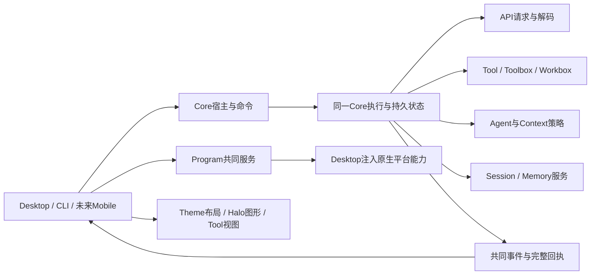

# Aieyra OS · 工程地图

这是模块职责与实际入口的开发导航。代码、运行状态和验收结论分别核对；这里的 `active` 表示有实际入口，`compatibility` 表示兼容层，`contract` 表示仅有接点或契约，均不表示工单全部完成。

[机器地图](工程地图.json)保存模块 ID、真实入口、就近工作协约、依赖、资料所有权、验证入口与未完成项。[根协约](../AGENTS.md)规定开发边界，验收依据实际构建和对应测试证据确认。私人原文、进度与运维材料不进入公共地图。

## 从哪里开始

| 要处理的事情 | 真实入口与责任 | 当前边界 |
| --- | --- | --- |
| 主进程与共同执行 | [Core 协约](../Core/AGENTS.md)、`Core/cmd` → `Core/host` → `Core` | Core 管授权、模型/工具/Agent执行、取消、事件与持久提交；入口装配可引用客户端，Core根包不反向引用Client |
| Mod兼容与安装 | [modules](../Core/modules/AGENTS.md)、[extensionhost](../Core/extensionhost/AGENTS.md)、[Contracts](../Contracts/AGENTS.md) | 同一服务供桌面/CLI/模型使用；安装、启用、应用、创建实例是不同操作 |
| 完整UI主题与官网媒体 | [Theme](../Theme/AGENTS.md)、[当前调用图43](项目地图/43-Mod与主题程序运行时.md) | 布局、元素状态、正文/思考/工具等语义槽位、资源/预设和恢复；官网主题浏览、头像/背景随机计划；验证方法见模块协约 |
| 光圈与配套动画 | [Halo](../Halo/AGENTS.md)、[专题53](项目地图/53-光圈SDK与模块协约.md) | 独立Mod、图形/状态/切页动画；Theme管页面，Agent管身份，默认与自定义不叠加两套外环 |
| 模型与厂商协议 | [API](../API/AGENTS.md)、[调用图44](项目地图/44-API与公共模型协议.md) | transport/request/codec/parameters/catalog/images/search/adapter分责；四协议及声明式适配已接入，真实供应商矩阵未全部验收 |
| 原子工具与Toolbox | [Tool](../Tool/AGENTS.md)、[调用图46](项目地图/46-工具实现与配套呈现.md)、[动态包51](项目地图/51-可导入工具包与回执呈现.md) | schema、手册、一次执行与完整双端可视化属于工具；Core持有权限、进程、恢复和提交 |
| 多步工作流 | [Workbox](../Tool/workbox/AGENTS.md)、[调用图52](项目地图/52-工作流与持久专职Agent.md) | 步骤/审阅/恢复与临时或保留型专员；重开查事实，未知副作用不重发 |
| Agent设计与实例 | [Agent](../Agent/AGENTS.md)、[定义图47](项目地图/47-Agent定义与执行契约.md) | 官方Eyra/Vaya/Cota定义、标准包/私人实例/团队与受限管理；执行仍由同一Core AgentManager负责 |
| 上下文与记忆 | [Agent/context](../Agent/context/AGENTS.md)、[Core/sessionservice](../Core/sessionservice/AGENTS.md)、[Core/memoryservice](../Core/memoryservice/AGENTS.md)、[调用图48](项目地图/48-上下文策略与宿主边界.md) | 策略不拥有数据库或凭据；Core提交档案/目录/记忆事务。共同Session记录存取和CLI/桌面管理已接入，长期恢复待复核 |
| 程序及人机协作 | [Program](../Program/AGENTS.md)、[browser](../Program/official/browser/AGENTS.md)、[servers](../Program/official/servers/AGENTS.md)、[link](../Program/official/link/AGENTS.md)、[workspace](../Program/official/workspace/AGENTS.md) | 当前四程序业务与实际视图归Program，Desktop注入平台能力；便签退役源码已归档工程外，旧私人资料保留，产品入口及发现均拒绝 |
| 桌面平台/窗口 | [Desktop](../Client/Desktop/AGENTS.md)、[客户端图45](项目地图/45-客户端与共同核心.md) | 实际源码已归Client/Desktop；根Desktop仅保留21份固定Program兼容资源；旧实现退役前须核对活动消费者 |
| CLI与未来手机端 | [Client/CLI](../Client/CLI/AGENTS.md)、[Client/Mobile](../Client/Mobile/AGENTS.md) | CLI是实际实现，独立CLI服从阶段开关；OS手机App只有契约。Control/mobile保留另一个产品的历史源码/APK，当前独立构建入口拒绝执行 |
| 本机/远端Link | [Control/app](../Control/app/AGENTS.md)、[Link](../Link/AGENTS.md) | Control/app拥有本机服务/网页，Link/app/link-core是独立Go模块；Core/link仍有消费者；远端、原生接收和执行分别核验 |
| 资料根与搬家 | [storage](../Contracts/storage/AGENTS.md)、[userdata](../Core/userdata/AGENTS.md)、[归属图49](项目地图/49-私人资料路径与清理归属.md) | 声明的资料分区共同解析；初始化与离线迁移已接入，合成资料恢复已验证；真实资料迁移须离线校验并保留原件 |
| Mod作者流程 | [SDK](../SDK/AGENTS.md)、[样板协约](../SDK/examples/AGENTS.md)、[专题53](项目地图/53-光圈SDK与模块协约.md) | 16样板、签名/CLI安装升级回退与模板闭环有证据；不等于全部样板运行/界面都验过 |
| OS 内部 Link | [独立 Go 模块](../InternalLink/README.md) | 邮箱协议由内部 Link 提供，Core 执行并保存同一会话的消息和代次 |
| 检查与实际验收 | [AIDEBUG 协约](../AIDEBUG/AGENTS.md)、[操作手册](AIDEBUG.md) | 日常窗口原生控件和屏幕证据，后台读取同一运行态 |
| 构建、更新与公开导出 | [scripts](../scripts/AGENTS.md)、[开发指南](开发指南.md)、`Contracts/product-layout.json` | 四产物从主工程直接构建；开发文档按development-documents精确清单提供并标出未随包提供的入口，私人资料永不公开 |

## 三条共同调用链



客户端输入不能绕过Core授权和提交边界。人和Agent访问Program的同一业务服务；Desktop提供窗口、文件、加密、SSH和Electron能力。Theme/Halo/工具视图消费真实状态，切页、换主题或窗口拆放不能重建任务、丢草稿或重复副作用。

Mod作者 → `SDK/tools/package.cjs` → `Core/modules` 检查与登记 → `Core/extensionhost` 类型准入 → 各模块实际消费者。精确包摘要绑定依赖/实例/当前选择；更新不自动扩权或迁移资料。官方来源由宿主编译的摘要目录验证，自报名字、路径或命名空间不能授予官方身份。

旧启动入口/旧页面 → 兼容转接 → 当前唯一实现。浏览器、服务器的旧Desktop路径仍服务可能缓存旧目录的运行宿主；删除前必须核对活动消费者。便签已退役，兼容文件和既有资料的留存不表示允许重新打开。Client/Desktop是唯一桌面实现，Client/Mobile仍只有契约。

## 资料和文件怎样放

| 范围 | 所有者与规则 |
| --- | --- |
| 公共配置与资源 | Config默认值、阶段开关、提示词索引；[Config协约](../Config/AGENTS.md)。私人活动配置不为验收复位 |
| 公开提示词 | Agent/official与所属Tool为唯一公共资源，经索引热读；[提示词目录与维护协约](提示词目录.md)。私人层归角色，旧实例兼容及迁移状态见该页 |
| 旧私人布局 | Config/Data及显式外部目录继续由共同路径绑定兼容；不通过新建空库“修复”旧库路径 |
| 统一资料根 | 有效资料根声明启用Config、Overrides/Prompt、Sessions、Assets、Packages等分区；[storage说明](../Contracts/storage/README.md)列初始化/离线迁移命令 |
| 包和程序资料 | 公共载荷、作者源、包登记和私人实例分开；包卸载不删除会话、记忆或用户程序内容 |
| 用户产物 | 由授权工作目录持有；记忆、会话、附件及runtime状态不是普通用户产物，也不是可清空缓存 |
| 运行依赖 | 根runtime/search、Client/Desktop/runtime、node_modules与Control运行时按锁和许可维护；第三方子目录由上层协约说明，不逐文件插文档 |
| 临时与证据 | 工程外保存失败原件、合成资料、截图与回执；不直接打开真实SQLite，不将私有证据正文放公共地图 |
| 精确清单包 | Agent官方角色、Halo经典包和SDK样板由包外协约逐包覆盖；不向manifest载荷内添加AGENTS或临时文件改变摘要 |

资料迁移先释放真实写者，再复制/校验/切换并保留原件；路径所有权不授予递归删除权限。Session归档、Context策略状态、Memory长期记忆和用户产物有不同生命周期，不能由单一“清理目录”操作替代。

## 按职责验证

| 范围 | 核心检查 |
| --- | --- |
| 包与作者流程 | 本地/ZIP、摘要与签名、依赖和权限、启停/回退/卸载、旧版本和故障恢复 |
| Theme、Halo 与呈现 | 完整语义槽位、真实状态、默认/可选主题、隐藏与减少动效、草稿/焦点/滚位保留 |
| 工具与工作流 | 输入和完整回执、CLI回退、成功/失败/取消/未知、审阅和恢复，未知副作用不重放 |
| Agent 与上下文 | 独立权限和资料、版本锁定、工具配对、原文回查、多次压缩与跨会话隔离 |
| API | 协议双轮工具、尾帧/断流/取消、参数、用量和缓存来源，供应商实测单独记录 |
| 程序与客户端 | 同一人机服务、控制权、内嵌/拆出/恢复、原生窗口与平台边界 |
| 资料与发行 | 初始化/迁移/删除重试、交付库存、升级/回滚、隐私与导航 |

## 地图维护与验收边界

新增自有模块或独立子模块时，先补就近AGENTS与机读条目，写出实际入口、数据归属、验证方式和未完成部分。同一份职责不在多个目录复制实现；测试/资产/供应商依赖可由上层具体说明，不能以空目录和空模板声称模块化。

```text
python -B scripts/check-project-map.py
python -B scripts/check-modules.py
```

第一条检查模块路径、ID、依赖、协约和所声明文档的本地链接；第二条检查源码模块/客户端依赖边界。文档路径校验不证明实现状态，第二条也不代替GUI、真实模型或性能验收。完整场景与看图流程见AIDEBUG操作手册，避免重复已通过且未受改动影响的验收。


## 会话与界面的共同入口

`contacts → conversation/session-status → host sessionModel/requests_sessions → Core conversation_model/conversation_usage/conversation_greeting` 维护会话入口、快捷模型、用量和问候。联系人分区编辑同一份原文，零会话默认由 `conversation_contacts` 保存。

`chat-column / bindChatSurface / subscribeWindowTheme` 统一首页、私聊、群聊与招呼。Toolbox 的 `system` 门面按 section 映射原权限、手册与服务。实际界面、真实供应商、远程 SSH、跨设备与各平台分别验证，不从地图状态推断通过。

浮动聊天与背景程序：OS会话和程序内会话复用layered-chat/chat-column/work-transcript；程序工具用folded-overlay的独立work表面，背景不改聊天几何。联系人sessions仅OS、program_session为固定程序绑定。浏览器owner/group_id/profile分别管理会话归属、工作实例和登录身份，具体边界见[一环运行与投影](一环运行与投影.md)。
